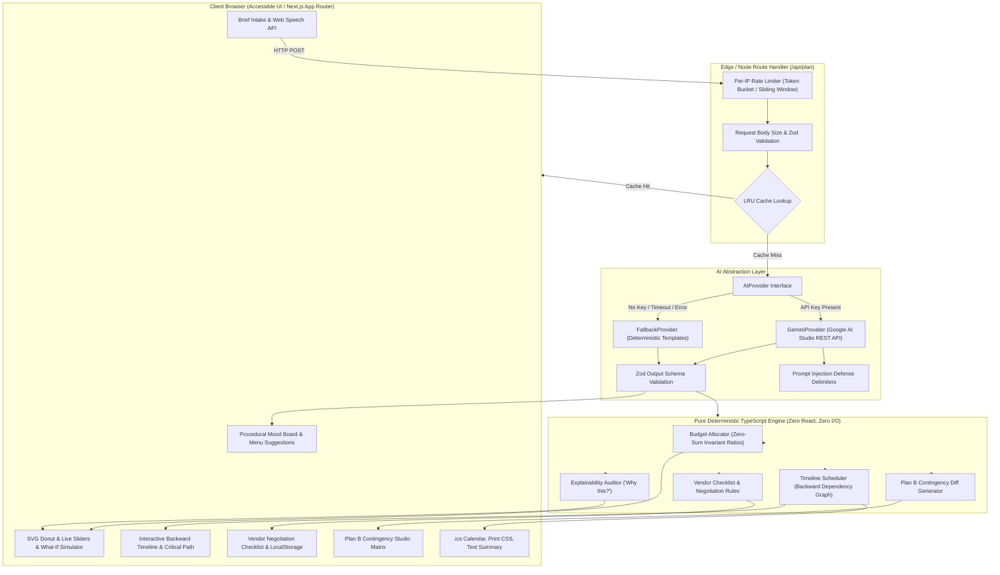

# Jashn Architecture Documentation

## 1. System Overview
**Jashn** is a GenAI-powered celebration and event planner architected around a strict separation of concerns:
> **LLM for natural language understanding and aesthetic creativity. Pure deterministic TypeScript for mathematical invariants, scheduling, dependency graphs, and risk rules.**

The application runs seamlessly with or without an active AI Studio API key through structured fallback templates and zero-cloud-SDK implementations.

---

## 2. Mermaid Architecture Diagram

---

## 3. Data Flow & Deterministic Invariants
1. **Intake Processing**: Raw user text is sanitized to strip malicious control characters and prompt-injection keywords (`system:`, `ignore instructions`, etc.).
2. **AI Provider Pipeline**:
   - `GeminiProvider` connects directly via HTTP `fetch` to Google AI Studio REST endpoints. No GCP SDKs are loaded.
   - Outputs are constrained with `responseMimeType: "application/json"`.
   - Results are strictly validated against `ParsedBriefSchema` and `CreativeIdeasSchema`.
   - If missing, invalid, or timed out (10s), `FallbackProvider` deterministically takes over.
3. **Pure Engine Invariants**:
   - **Zero-Sum Budget**: $\sum \text{Allocations} \equiv \text{Total Budget}$. Adjusting any category slider proportionally rebalances flexible categories without drift or negative numbers.
   - **Backward Scheduling**: Milestones calculate offsets backward from event date with dependency ordering.
   - **Compression Alert**: Events scheduled under 12 weeks are flagged as compressed with immediate "book this week" priorities.
   - **Deterministic Contingencies**: Instant mathematical diffs for sudden rain, vendor cancellations, guest surges (+30%), and budget cuts (-15%).
